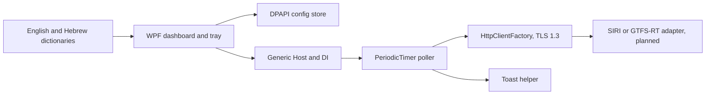

# BusPulse


BusPulse is a Windows system-tray bus notifier baseline. It is designed for per-user installation, route-aware arrival reminders, walk-time buffers, and quiet operation between active journeys.

> This repository is a starter baseline, not a transit-ready release. OpenBus polling is connected, but live schema verification, arrival-time calculations, notifications, installer, test suite, and signed obfuscation pipeline remain incomplete.

## Current Baseline

- WPF desktop shell starts hidden in the notification area, with double-click to open and a tray menu for mute, profile selection, settings, and exit.
- English/Hebrew resource dictionaries can be switched at runtime; Hebrew applies right-to-left flow direction to the dashboard.
- Settings are serialized as JSON in memory and encrypted with Windows DPAPI `CurrentUser` before writing under `%LOCALAPPDATA%\BusPulse`.
- The `OpenBusService` calls the Hasadna SIRI rides endpoint over TLS 1.3, caps response bodies, parses strict JSON, and filters records by common line-name fields. The live response schema could not be verified because the API hostname did not resolve in the development environment.
- Choose a named start and destination from DPAPI-protected saved places. Add places such as Home under Saved places; each currently requires an OpenBus stop code because address/map search is not connected. Save and check queries the selected start stop, then the background poller retries it.
- A toast XML builder helper is present. Windows notification delivery is not wired yet; unpackaged desktop delivery requires the app identity/Start Menu shortcut registration described below.

## Architecture



## Prerequisites

- Windows 10 or 11 x64. TLS 1.3 support is required by the current strict transport configuration; older Windows builds may not connect.
- .NET 8 SDK and Windows Desktop Runtime. .NET 8 support ends November 10, 2026; plan a supported-runtime upgrade before then.
- Visual Studio 2022 with the .NET desktop workload, or VS Code with C# Dev Kit and the .NET SDK.
- Internet access, at least two saved places with valid OpenBus stop codes, and a line name. The endpoint currently requires no API key.
- Human decisions: provider and feed terms, supported service area, stop/route UX, notification policy, supported Windows versions, and signing/installer identity.
- For production toast notifications in an unpackaged app: register an AUMID and Start Menu shortcut during per-user setup. Do not request elevation for this.

No credentials are needed to build the current scaffold. Do not place credentials in source control or plaintext config files. The current baseline encrypts its complete settings document with per-user DPAPI.

## Build and Run

From the repository root on Windows with the .NET 8 SDK installed:

```powershell
dotnet restore .\BusPulse\BusPulse.csproj
dotnet build .\BusPulse\BusPulse.csproj -c Release
dotnet run --project .\BusPulse\BusPulse.csproj
```

To publish a per-user, framework-dependent build:

```powershell
dotnet publish .\BusPulse\BusPulse.csproj -c Release -r win-x64 --self-contained false
```

The project builds successfully in this environment using .NET SDK 10.0.401 while targeting `net8.0-windows`.

## Security Notes

- OpenBus is called at a fixed HTTPS origin; the configured HTTP handler requires TLS 1.3 and redirects are disabled.
- Response content length and streamed bytes are capped at 1 MiB. JSON comments/trailing commas are disabled and nesting is bounded. A provider-specific schema and semantic validation must be added before consuming feed fields.
- DPAPI `CurrentUser` protects settings for the current Windows profile. It is not a substitute for least-privilege ACLs, secure backups, or secret rotation.
- There is no installer or elevation manifest in this baseline. Keep installation in the user's profile and avoid machine-wide registry/file locations.
- Obfuscation is not enabled. Select a maintained, licensed obfuscator and validate signing, crash reporting, and false-positive behavior before adding a release pipeline.

## MCP Workflow Setup

MCP integrations are a workflow proposal, not configured servers in this repository. Add only trusted servers in the user's VS Code MCP configuration and review each server's filesystem, Git, network, and terminal permissions.

1. Use a filesystem server scoped to this repository for scaffold changes; review diffs before accepting generated files.
2. Use Git/GitHub servers for issue tracking and pull requests. Create separate feature branches for the four workstreams, then merge only through reviewed pull requests. Do not let an agent commit secrets or generated binaries.
3. Use terminal tooling for `dotnet restore`, `dotnet build`, `dotnet test`, and package auditing; capture results as CI artifacts.
4. Use fetch/documentation tooling against the selected agency's official SIRI/GTFS-RT documentation. Pin schema/spec versions and keep source URLs with generated models.
5. Keep credentials in user secrets or a credential store. Never pass production tokens to an MCP server unless its trust and retention policy has been reviewed.

## Delivery Plan and Assets

See [the four-agent execution plan](docs/agent-execution-plan.md) for scoped tasks, handoffs, and acceptance gates. See [asset specifications](docs/assets.md) for tray icon states and audio requirements. Icon and WAV binaries are intentionally not fabricated in this baseline.