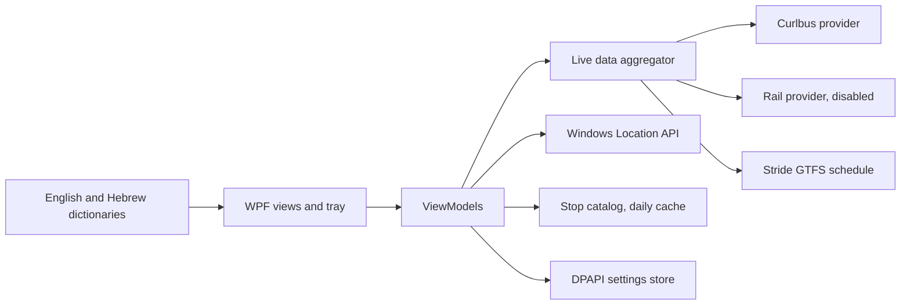

# BusPulse


BusPulse is a Windows desktop and system-tray monitor for Israeli public transport. It shows nearby stops with live or scheduled arrivals, is designed for per-user installation, and aims to give route-aware departure reminders with walk-time buffers.

> Work in progress, not a release. The Stops tab works end to end; trip planning, lines, notifications, the design pass and the installer are still open. See [docs/PLAN.md](docs/PLAN.md) for scope, decisions and status.

## Current State

- WPF app with MVVM (CommunityToolkit.Mvvm) and four tabs: Stops, Trip planner, Lines, Settings. It lives in the notification area with active, muted and alert icon states; double-click opens it and the tray menu offers mute, profiles, settings and exit.
- **Stops tab:** uses the Windows Location API (or a saved place) to list the nearest stops with distances, expands a stop to its next arrivals marked "live" or "scheduled", shows the source and freshness in a tooltip, and counts down in place.
- **Live data:** Curlbus is the primary live source. Stride GTFS provides the schedule fallback and the stop catalog (cached daily under `%LOCALAPPDATA%\BusPulse\cache`). An aggregator picks the freshest valid data per line and rejects stale or impossible values. The Israel Railways provider is disabled until an official key is configured. The public Stride SIRI feed is stale and is not used. Measured results are in [docs/live-data-probe.md](docs/live-data-probe.md).
- English/Hebrew resource dictionaries switch at runtime; Hebrew applies right-to-left flow direction.
- Settings (including saved places) are serialized as JSON and encrypted with Windows DPAPI `CurrentUser` under `%LOCALAPPDATA%\BusPulse`.
- A toast XML builder helper and a mute-aware sound service exist, but notification delivery is not wired yet; unpackaged desktop delivery requires the app identity and Start Menu shortcut registration described in the plan.

## Architecture



## Prerequisites

- Windows 10 (build 19041) or 11 x64. Network access uses the operating system's default TLS (1.2 or later).
- .NET 8 SDK and Windows Desktop Runtime. .NET 8 support ends November 10, 2026; plan a supported-runtime upgrade before then.
- Visual Studio 2022 with the .NET desktop workload, or VS Code with C# Dev Kit and the .NET SDK.
- Internet access. No API key is needed for the current sources. Saved places need a stop code.
- Human decisions: provider and feed terms, supported service area, stop/route UX, notification policy, supported Windows versions, and signing/installer identity.
- For production toast notifications in an unpackaged app: register an AUMID and Start Menu shortcut during per-user setup. Do not request elevation for this.

No credentials are needed to build the current scaffold. Do not place credentials in source control or plaintext config files. The current baseline encrypts its complete settings document with per-user DPAPI.

## Build and Run

From the repository root on Windows with the .NET 8 SDK installed:

```powershell
dotnet restore .\BusPulse.sln
dotnet build .\BusPulse.sln -c Release
dotnet test .\BusPulse.sln --filter "Category!=Live"
dotnet run --project .\BusPulse\BusPulse.csproj
```

Live probes against the real services run manually with `dotnet test --filter "Category=Live"`.

To publish a per-user, framework-dependent build:

```powershell
dotnet publish .\BusPulse\BusPulse.csproj -c Release -r win-x64 --self-contained false
```

The project builds successfully in this environment using .NET SDK 10.0.401 while targeting `net8.0-windows10.0.19041.0`.

## Security Notes

See [SECURITY.md](SECURITY.md) for stored data, contacted hosts and privacy rules.

- Provider calls use fixed HTTPS origins with the OS-default TLS, certificate validation on, redirects disabled, short timeouts and response size caps. Responses are parsed into strict models and validated (coordinates inside Israel, plausible timestamps) before use.
- DPAPI `CurrentUser` protects settings for the current Windows profile. It is not a substitute for least-privilege ACLs, secure backups, or secret rotation.
- There is no installer or elevation manifest in this baseline. Keep installation in the user's profile and avoid machine-wide registry/file locations.
- Obfuscation is not enabled. Select a maintained, licensed obfuscator and validate signing, crash reporting, and false-positive behavior before adding a release pipeline.

## MCP Workflow Setup

MCP integrations are a workflow proposal, not configured servers in this repository. Add only trusted servers in the user's VS Code MCP configuration and review each server's filesystem, Git, network, and terminal permissions.

1. Use a filesystem server scoped to this repository for scaffold changes; review diffs before accepting generated files.
2. Use Git/GitHub servers for issue tracking and pull requests. Create separate feature branches for the four workstreams, then merge only through reviewed pull requests. Do not let an agent commit secrets or generated binaries.
3. Use terminal tooling for `dotnet restore`, `dotnet build`, `dotnet test`, and package auditing; capture results as CI artifacts.
4. Use fetch/documentation tooling against the selected agency's official SIRI/GTFS-RT documentation. Pin schema/spec versions and keep source URLs with generated models.
5. Keep credentials in user secrets or a credential store. Never pass production tokens to an MCP server unless its trust and retention policy has been reviewed.

## Delivery Plan and Assets

See [docs/PLAN.md](docs/PLAN.md) for the merged plan, decisions, status and next steps, [docs/audit.md](docs/audit.md) for the requirement audit, and [docs/assets.md](docs/assets.md) for tray icon and audio requirements. Icons (`bus_active`, `bus_muted`, `bus_alert`) and sounds (`arrival.wav`, `delay.wav`) are original, generated by `tools/generate_icons.py` and `tools/generate_sounds.py` into `BusPulse/Assets`.
