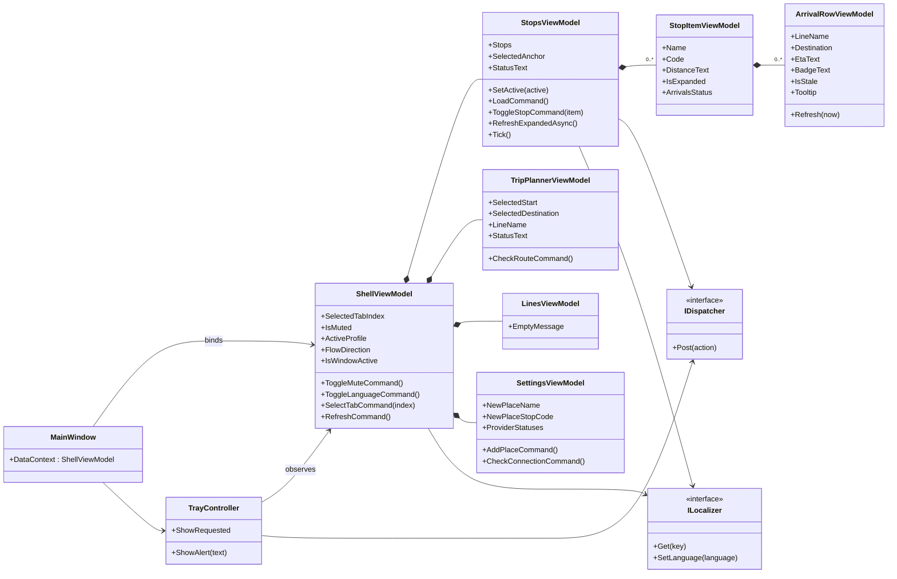
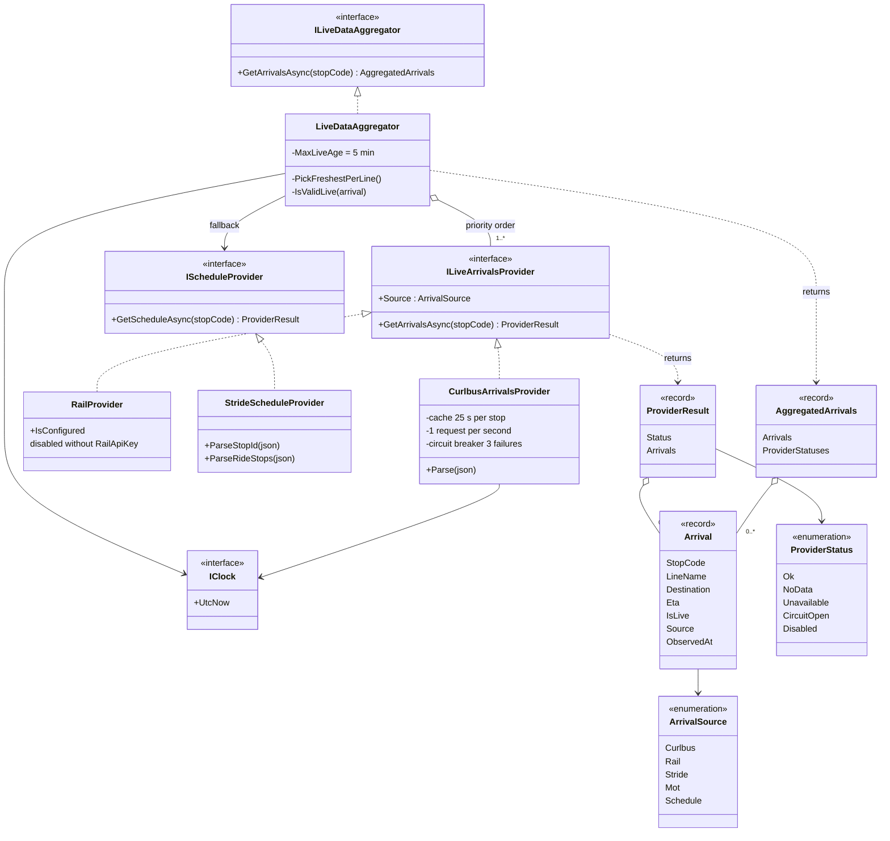
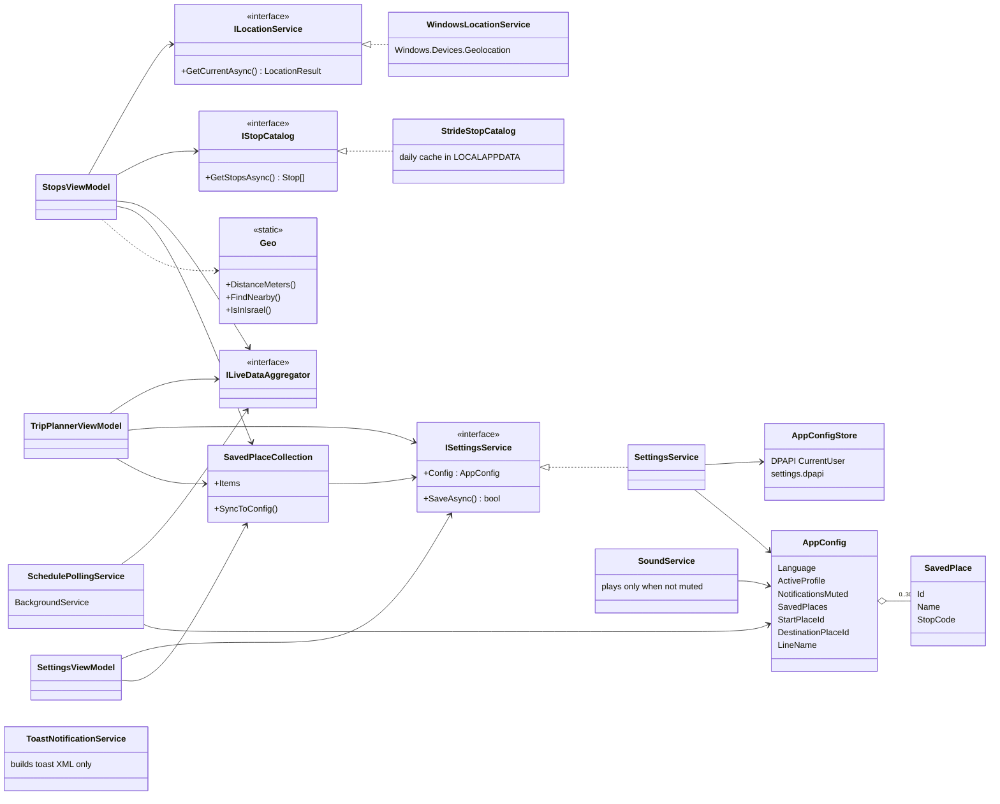
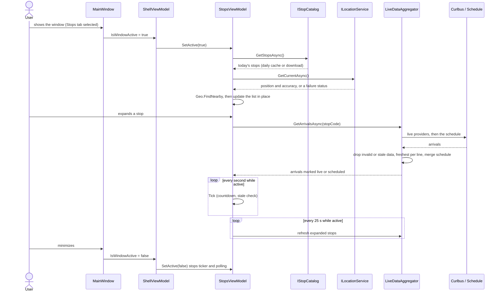

# BusPulse UML

Diagrams are Mermaid, so they render on GitHub and in the VS Code Markdown preview. They reflect the code as of 2026-10-20; members are abbreviated to the ones that matter for understanding the design.

## 1. Presentation layer (MVVM)

## 2. Live data layer

## 3. Services, location and configuration

## 4. Sequence: opening the Stops tab

